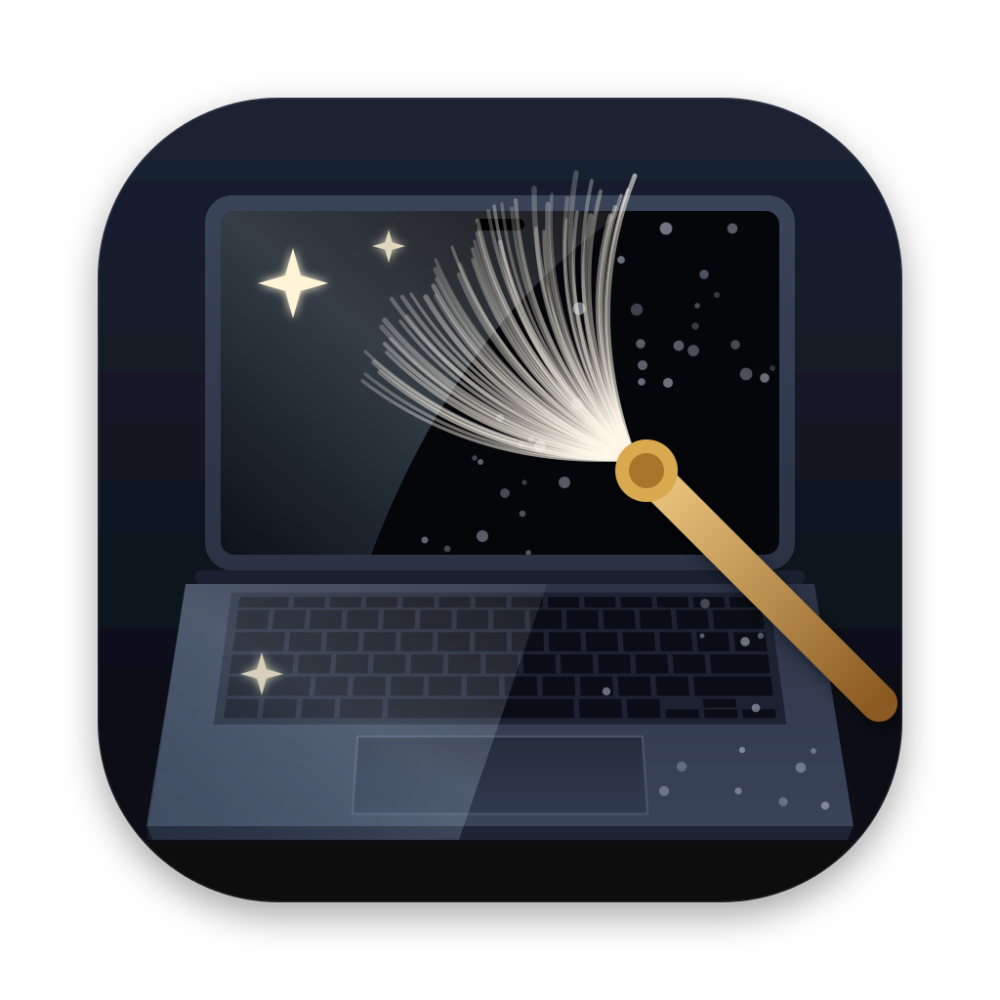
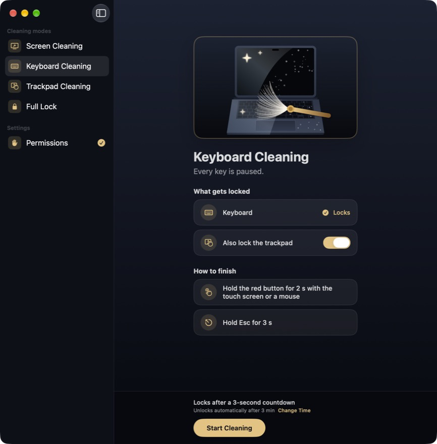
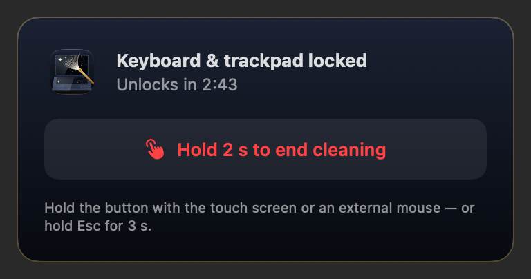
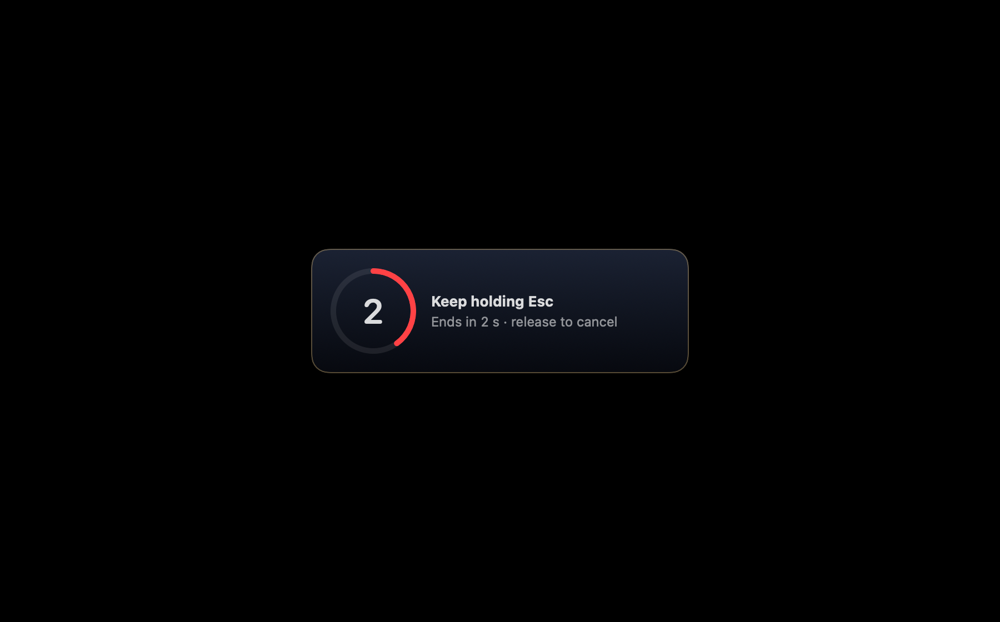
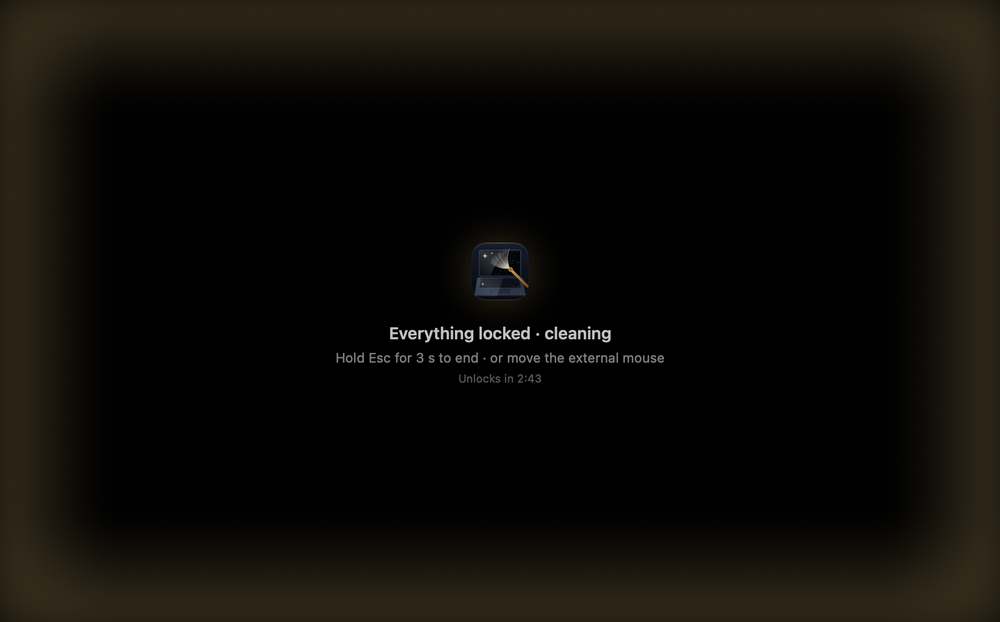

<p align="center">
  
</p>

<h1 align="center">Fushi — Cleaning Lock for the Touch Screen MacBook Pro</h1>

<p align="center">
  <b>Wipe your screen, keyboard and trackpad without pressing anything.</b><br>
  Built for the <b>2026 MacBook Pro with touch screen (M5 · PROLED XDR)</b> — Apple's first touch-screen Mac.<br>
  Also supports Macs without a touch screen, on macOS 14 Sonoma or later.
</p>

<p align="center">
  English · <a href="README.zh-Hant.md">繁體中文</a>
</p>

<p align="center">
  
</p>

## Why

On a touch-screen MacBook Pro, wiping the PROLED XDR display taps buttons, and wiping the keyboard deck types into whatever app is in front. Fushi temporarily locks exactly what you are cleaning, then unlocks automatically when time is up.

## Four modes

| Mode | What it locks | How to finish |
|---|---|---|
| **Screen Cleaning** | The screen goes black; taps on the touch screen press nothing | Hold <kbd>Esc</kbd> for 3 s, or wait |
| **Keyboard Cleaning** | Every key, including brightness, volume and media keys. "Also lock the trackpad" is on by default | Hold the red button for 2 s with the touch screen or a mouse |
| **Trackpad Cleaning** | Only the built-in trackpad; the keyboard and external mice keep working | Hold the red button with the touch screen or an external mouse |
| **Full Lock** | Black screen + keyboard + trackpad + touch screen; only an external mouse works | Move the mouse and hold the red button — or **unplug the mouse to unlock instantly** |

<p align="center">
  
</p>

## Designed so you can always get out

- **Hold <kbd>Esc</kbd> for 3 seconds** ends any mode, even with the keyboard locked. A 3‑2‑1 ring shows the progress.
- **Auto-unlock** after 30 s – 10 min (3 min by default), backed by independent timers that do not rely on the main thread.
- **Unplug the external mouse** in Full Lock and everything unlocks immediately.
- If Fushi crashes or is force-quit, the lock disappears with it. Fushi never changes system settings.
- Turning off the Accessibility permission during cleaning releases the lock within about 2 seconds.

<p align="center">
  
  
</p>

While the screen is black, touching the keyboard or trackpad makes a gold glow breathe around the edges — the Mac is still on, and the hint tells you how to finish. Wiping the touch screen does not trigger it.

## Install

1. Download the latest `Fushi-…-macOS-Universal.zip` from [Releases](../../releases) and unzip it.
2. Move **Fushi.app** to Applications and open it.
   Fushi is not notarized by Apple (it is a free open-source app). If macOS blocks it, open **System Settings › Privacy & Security** and click **Open Anyway**.
3. For keyboard, trackpad and full-lock cleaning, allow **Accessibility** when Fushi asks (System Settings › Privacy & Security › Accessibility). Screen cleaning needs no permission.

Requirements: macOS 14 Sonoma or later. Universal app for Apple silicon and Intel; tested on Apple silicon.

Known limits: while a password field is active (macOS Secure Input), no app can lock the keyboard, so Fushi asks you to leave the field first. The power button and Touch ID are handled by the hardware and cannot be locked — avoid them while cleaning.

## Privacy

- Fushi blocks input only while cleaning. It **never records what you type** and has **no network access**.
- Diagnostics stay on your Mac (unified log) and are copied only if you choose "Copy Diagnostics".
- Found a security problem? Please report it privately — see [SECURITY.md](SECURITY.md).

## Languages

English, 繁體中文, 简体中文, 日本語, 한국어, Español — chosen automatically from your system language (anything else falls back to English). Want to add yours? See [docs/TRANSLATING.md](docs/TRANSLATING.md).

## How it works

- Screen Cleaning covers every display with a black window above the menu bar and Dock.
- Keyboard locking uses an active `CGEventTap` that drops key and media-key events.
- Trackpad locking identifies **which physical device sent each pointer event** and drops only those from the built-in trackpad, so external mice and the touch screen keep working. This uses a private IOKit function; if a future macOS removes it, Fushi lets every event through instead of locking you out.
- Every lock has its own watchdog timer, hold-Esc timer and permission check — none of them depend on the UI thread.

## Build from source

Requires Xcode and [XcodeGen](https://github.com/yonaskolb/XcodeGen).

```bash
scripts/build.sh
```

This generates the project, runs the unit tests, builds a Release app and copies `Fushi.app` to the project folder. To open in Xcode: `xcodegen generate && open Fushi.xcodeproj`.

Development notes:
- Builds are ad-hoc signed. `signing/Fushi.req` pins the Release app's code-signing identity to its bundle ID, so the Accessibility permission survives rebuilds.
- The Debug build is a separate app ("Fushi Dev", bundle ID `…Fushi.debug`) whose auto-unlock is capped at 30 seconds, so a bug can never lock you out for long.
- Run unit tests with `xcodebuild -scheme Fushi test`. Debug-only tools: `-FushiSnapshot <folder>` renders the lock panels to PNG without locking anything.

The repository also contains **FushiProbe**, a listen-only diagnostic tool used during development to measure how the touch screen, trackpad and mice appear to macOS (see `docs/PROBE-GUIDE.md`).

## License

The source code is licensed under the [Apache License 2.0](LICENSE): you may use, modify and redistribute it.

The app icon and illustrations (`Design/` and the image sets in `Assets.xcassets`) are **not** covered by the Apache License — all rights reserved. The name "Fushi" / "拂拭" identifies the official app. Forks must use their own name, icon and artwork (see [NOTICE](NOTICE)).

Fushi is an independent project and is not affiliated with, endorsed by, or sponsored by Apple Inc. Apple, Mac, MacBook Pro, macOS and Touch ID are trademarks of Apple Inc.

Ideas (no code copied) from LinearMouse (identifying the source device of an event), Mac Pause and KeepClean.

The name comes from a Zen verse: *"Wipe it diligently, and let no dust gather."* (時時勤拂拭，勿使惹塵埃)
