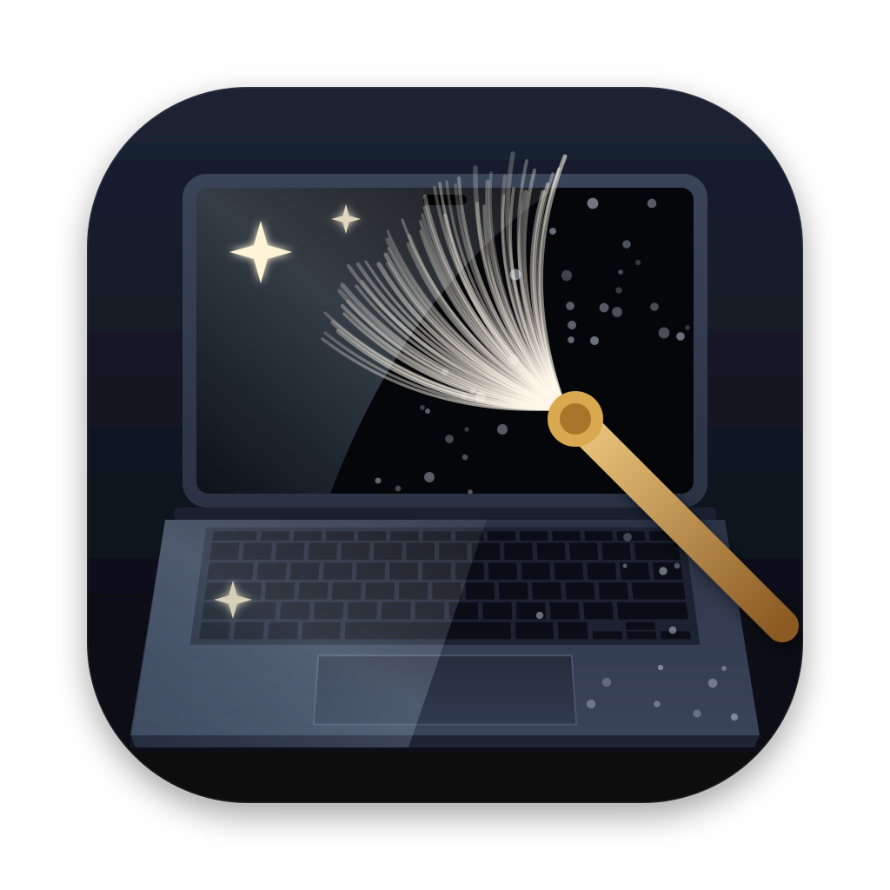
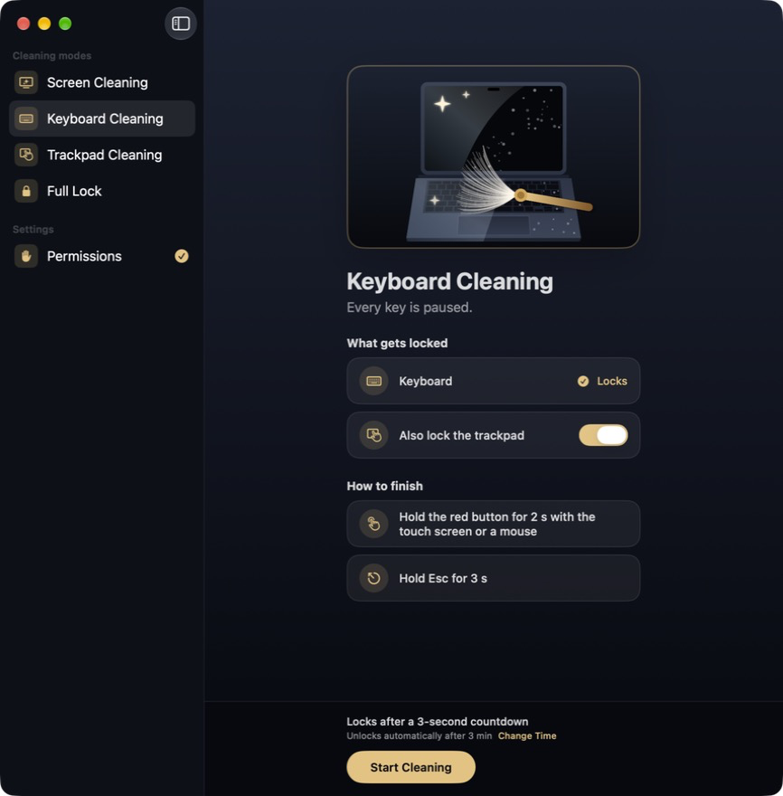

<p align="center">
  
</p>

<h1 align="center">拂拭 (Fushi) — 觸控螢幕 MacBook Pro 的清潔鎖</h1>

<p align="center">
  <b>擦螢幕、擦鍵盤、擦觸控板時，不會按到任何東西。</b><br>
  專為 <b>2026 年觸控螢幕 MacBook Pro (M5 · PROLED XDR)</b> 設計 —— Apple 第一代觸控螢幕 Mac。<br>
  沒有觸控螢幕的 Mac 也能用，支援 macOS 14 Sonoma 以上。
</p>

<p align="center">
  <a href="README.md">English</a> · 繁體中文
</p>

<p align="center">
  
</p>

## 為什麼需要

觸控螢幕 MacBook Pro 擦 PROLED XDR 螢幕時會點到按鈕，擦鍵盤時會打字進前景的 App。拂拭會在清潔期間暫時鎖住你正在擦的部位，時間到自動解鎖。

## 四種模式

| 模式 | 會鎖住 | 怎麼結束 |
|---|---|---|
| **螢幕清潔** | 螢幕全黑，觸控螢幕點了沒反應 | 長按 <kbd>Esc</kbd> 3 秒，或等時間到 |
| **鍵盤清潔** | 所有按鍵 (含亮度、音量、播放鍵)；「同時鎖住觸控板」預設打開 | 用觸控螢幕或滑鼠按住紅色按鈕 2 秒 |
| **觸控板清潔** | 只鎖內建觸控板，鍵盤和外接滑鼠照常 | 用觸控螢幕或外接滑鼠按住紅色按鈕 |
| **全部鎖定** | 螢幕全黑＋鍵盤＋觸控板＋觸控螢幕，只留外接滑鼠 | 動一下滑鼠按住紅色按鈕；**拔掉滑鼠立刻解鎖** |

## 一定解得開

- **長按 <kbd>Esc</kbd> 3 秒**：任何模式都能結束，鍵盤鎖住時也有效，畫面會出現 3、2、1 倒數圓環。
- **時間到自動解鎖**：30 秒～10 分鐘 (預設 3 分鐘)，有不經過主程式的獨立保險計時器。
- **全部鎖定時拔掉外接滑鼠**：立刻全部解鎖。
- 拂拭當掉或被強制結束時，鎖定會一起消失；拂拭不修改任何系統設定。
- 清潔中關掉「輔助使用」權限，約 2 秒內自動解除。

全黑時碰到鍵盤或觸控板，螢幕四周的金光會緩慢呼吸，提示電腦還開著、怎麼結束；擦觸控螢幕不會觸發。

## 安裝

1. 到 [Releases](../../releases) 下載最新的 `Fushi-…-macOS-Universal.zip` 並解壓縮。
2. 把 **Fushi.app** 移到「應用程式」資料夾並打開。
   拂拭是免費開源 App，沒有經過 Apple 公證。如果 macOS 擋下來，請到 **系統設定 › 隱私權與安全性**，按 **強制打開**。
3. 鍵盤清潔、觸控板清潔、全部鎖定需要 **輔助使用** 權限 (系統設定 › 隱私權與安全性 › 輔助使用)；螢幕清潔不需要權限。

需求：macOS 14 Sonoma 以上 · Apple 晶片與 Intel 通用。

## 隱私

- 只在清潔期間攔截輸入，**不記錄你按了什麼**，**不連網**。
- 診斷紀錄只存在你的 Mac 上，只有你按「拷貝診斷資訊」才會複製出來。

## 語言

英文、繁體中文、簡體中文、日文、韓文、西班牙文，依系統語言自動切換 (其他語言顯示英文)。想幫忙加入你的語言，請看 [docs/TRANSLATING.md](docs/TRANSLATING.md)。

## 原理

- 螢幕清潔：用全黑視窗蓋住所有螢幕 (高於選單列與 Dock)。
- 鎖鍵盤：主動式 `CGEventTap` 擋下按鍵與媒體鍵事件。
- 鎖觸控板：逐一查出**每個指標事件是哪個實體裝置送的**，只擋內建觸控板，外接滑鼠與觸控螢幕照常可用。這用到 IOKit 的未公開函式；如果未來 macOS 移除它，拂拭會改成全部放行，不會把你鎖住。
- 每一種鎖都有自己的保險計時器、長按 Esc 計時與權限檢查，全部不依賴畫面執行緒。

## 從原始碼建置

需要 Xcode 與 [XcodeGen](https://github.com/yonaskolb/XcodeGen)。

```bash
scripts/build.sh
```

會產生專案、跑單元測試、建置 Release 版，並把 `Fushi.app` 複製到專案資料夾。想用 Xcode 開啟：`xcodegen generate && open Fushi.xcodeproj`。

開發者注意：
- 使用 ad-hoc 簽章；`signing/Fushi.req` 把 Release 版的簽章身分固定成 Bundle ID，重新建置後「輔助使用」權限不會失效。
- 開發版是另一個 App (「Fushi Dev」，Bundle ID `…Fushi.debug`)，自動解鎖上限 30 秒，程式有 bug 也不會把你鎖太久。
- 開發版工具：`-FushiSnapshot <資料夾>` 可以把鎖定面板直接畫成 PNG，不必真的鎖定。

專案裡另有開發用的 **FushiProbe 偵測工具** (只監聽、不攔截)，用來量測觸控螢幕、觸控板、滑鼠在 macOS 裡的樣子，說明見 `docs/PROBE-GUIDE.md`。

## 授權

[Apache License 2.0](LICENSE)：可以自由使用、修改、再發佈程式碼。「拂拭／Fushi」名稱與 App 圖示代表官方版本，衍生版本請使用自己的名稱與圖示 (見 [NOTICE](NOTICE))。

參考了 LinearMouse (分辨事件來源裝置)、Mac Pause、KeepClean 的概念，沒有複製程式碼。

名稱出自「時時勤拂拭，勿使惹塵埃」。
